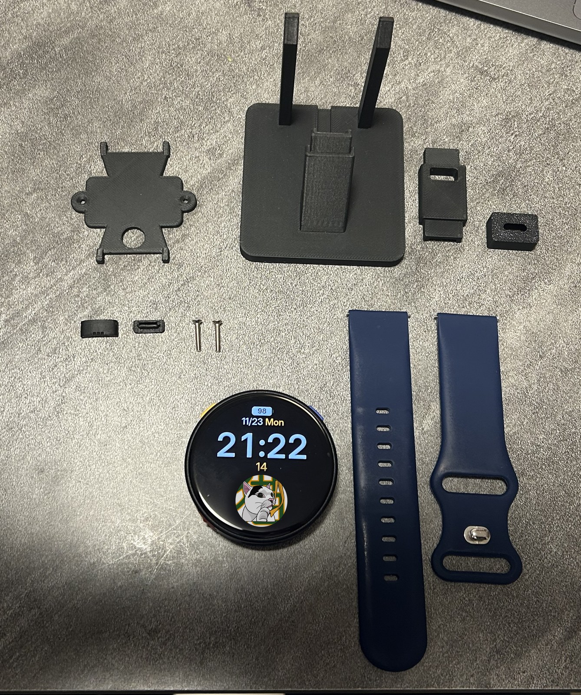
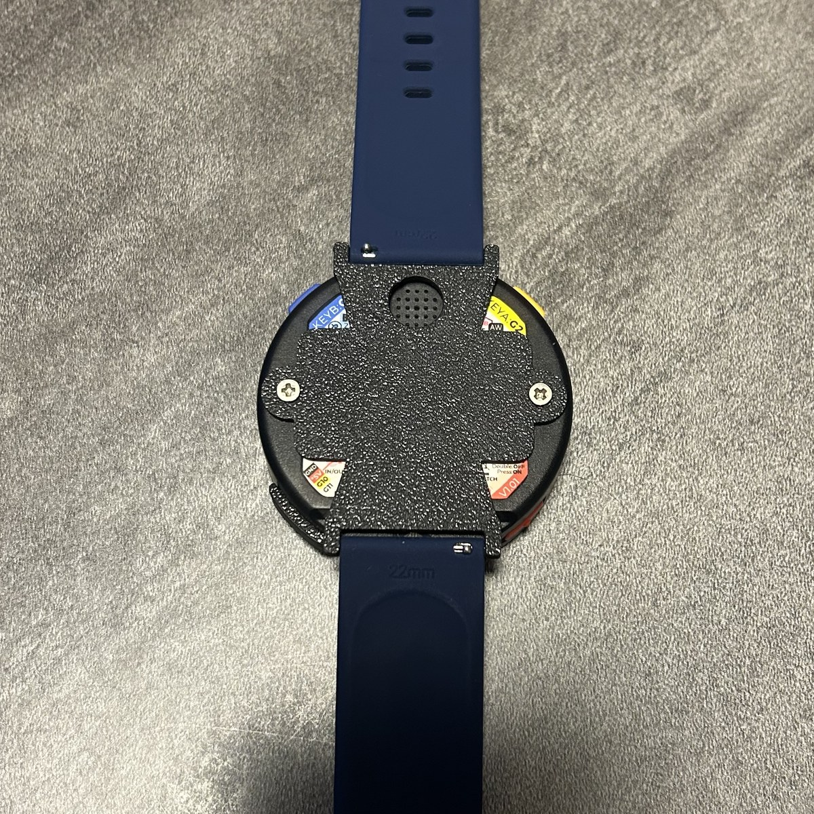
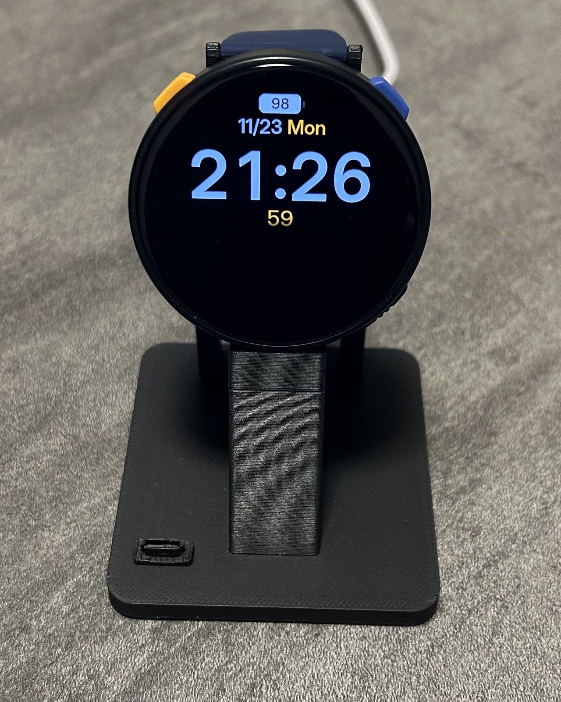

# 3D プリント部品

M5Stack StopWatch を腕時計・卓上時計として使うための 3D プリント部品です。
どれも OpenSCAD で設計していて、`.scad`（元データ）と `.stl`（そのまま刷れるデータ）を置いています。



## 部品

| フォルダ | 部品 | 刷る向き |
|---|---|---|
| `band_adapter/` | バンドアダプタ（22mm のバネ棒。Apple Watch 用の 22mm 変換バンドなど、一般的な時計バンドが付く） | 本体側の平らな面を下に |
| `stand/` | USB-C 充電スタンド（25° に傾けた卓上時計） | 下の「スタンド」を参照 |
| `caps/` | Grove 端子のキャップ、USB-C 端子のキャップ | ふたの外側を下に |

- プリンタ：Bambu Lab P1S、0.4mm ノズル、Textured PEI プレート、PLA で確認しています。
- どれも **サポートなしで刷れる** ように作っています（下向きの面は 45° 以内、水平な天井なし）。
- 寸法の単位は mm です。

### バンドアダプタ



- 本体背面の 2 本のネジ（M2 × 8）を外し、アダプタの板（2mm）をはさんで **M2 × 12 の皿ネジ** で留めます。
- バネ棒は本体の縁の下に来るので、画面側から見るとラグがほとんどはみ出しません。
- 背面のピンソケットを覆うので、汗が入りにくくなります。

### スタンド



USB-C ケーブルのプラグを塔の中に固定し、本体を上から差して充電します。3 つの部品に分かれています。

| 部品 | ファイル | 刷る向き |
|---|---|---|
| 台（塔の前半分と背もたれの柱が一体） | `stopwatch_split_stand_base.stl` | そのまま（約 3.5 時間） |
| 塔の後ろ半分 | `stopwatch_split_stand_back.stl` | 分割面を下に |
| キャップ | `stopwatch_split_stand_collar.stl` | 天板を下に |

- ケーブルは Apple 純正の USB-C 240W（編み込み）に合わせています。プラグの樹脂部分は幅 10 × 厚さ 4.5 × 長さ 14.5、ケーブル径約 4.6 です。ほかのケーブルを使うときは、`.scad` の先頭の寸法を変えてください。
- 組み立ての手順は次のとおりです。
  1. ケーブルの反対側のコネクタを、後ろ半分の背面の出口から通す
  2. プラグとケーブルを後ろ半分に入れる
  3. 後ろ半分の下の端を台の穴に差しながら、前半分に合わせる
  4. キャップをかぶせる
- 本体を抜くときは、もう片方の手で台を押さえてください（台が軽いので一緒に持ち上がります）。
- `.scad` の `part` を切り替えると各部品を書き出せます（`stand` / `back` / `collar`。確認用に `assembly` もあります）。

### キャップ

- Grove キャップ：栓の外周のつぶしリブで固定します。最初の版（リブ 0.25mm）はきつくて入らなかったので、リブを 0 / 0.10 / 0.15 / 0.20mm にして試し刷りし、0.15mm にしました。きつさが合わないときは `.scad` の `rib_h` を変えてください。
- USB-C キャップ：差し込み口の左右のバネで保持します。TPU か PETG を想定しています。

## STL の書き出し

OpenSCAD があれば、次のコマンドで書き出せます。

```sh
openscad -o stand.stl -D 'part="stand"' stand/stopwatch_split_stand.scad
```

OpenSCAD を入れずに、Node.js で OpenSCAD の wasm 版を動かして書き出すこともできます。

```sh
cd tools && npm install
node render2.mjs ../stand/stopwatch_split_stand.scad stand.stl 'part="stand"'
```

`tools/check_assembly.py`（Python + trimesh）で、組み立てたときに部品どうしやプラグが干渉しないかを調べられます。

## 寸法の出典

本体の形は M5Stack 公式の構造データ（[M5_Hardware](https://github.com/m5stack/M5_Hardware) の `StopWatch.stl`、MIT）から読み取り、
寸法が合わないところは実測して直しました。このリポジトリには公式のデータそのものは入っていません。

- 本体：直径 52 / 厚さ 15.5、USB-C は 6 時の側面
- 背面のネジ：M2、X = ±20（3 時・9 時の方向）

## 失敗した版（`archive/`）

うまくいかなかった版も経緯の参考として `.scad` を残しています。

バンドアダプタの古い版は `old_parts/` にあります。

| ファイル | 考え方 |
|---|---|
| `stopwatch_band_plate.scad` | 最初の版。背面の拡張ソケットにピンヘッダを挿して位置を決め、外周のクリップで本体の縁を抱える |
| `stopwatch_screw_adapter.scad` | 背面のネジを長いものに替えて共締めし、背面の凹みにはまる「キー」で回り止め |
| `stopwatch_cover_adapter.scad` | 背面全体を覆う薄い板。皿ネジで頭を沈め、ラグの耳を本体側に立ち上げる |

今の `band_adapter/` はカバー型からキーとネジ穴の筒をなくして本体側を平らにし、ラグを本体の縁の下に入れた版です。

充電スタンドの古い版は `old_parts/stopwatch_charge_stand.scad` と `split_stand_history/` にあります。

| ファイル | 考え方 | どうなったか |
|---|---|---|
| `old_parts/stopwatch_charge_stand.scad` | 一体型。プラグを塔に入れ、裏ぶたをはめて固定 | 分割型に作り直した |
| `…_v3_collar_only.scad` / `…_v4_cap_pins.scad` | 塔を左右に分割してプラグを挟む。上にキャップ | ピンで留める案は見た目がよくないのでやめた |
| `…_v5_flush_nopin.scad` | 0.3mm のポッチとくぼみで塔を台に固定 | 抜けた |
| `…_v6_frontback_snap.scad` | 塔を前後に分割。しなる爪と窓で固定 | 抜けた。窓の縁が刷るときのオーバーハングになって斜面のように働き、爪が外れた |
| `…_v7_fused_front.scad` | **塔の前半分を台と一体にする** | 抜けなくなった（今の版の元） |
| `…_v8_brace.scad` | 背もたれの柱を「へ」の字の梁でつなぐ | 見た目がいまひとつ → 梁をやめて柱を太くした今の版へ |

この経緯から学んだことは次のとおりです。

- 寸法はデータより、実物（プラグ）を測った値を信じる。プラグの入れ口を長く（18mm）しすぎて、プラグが沈んで奥まで刺さらず充電できなかったことがある
- 0.4mm の薄い「ふち」を塔の上に作ったら、縦 1 本線の壁になって刷れなかった。平らに刷れるキャップの天板に移した
- 小さな引っかかりで抜け止めをしない。力の通り道を一体の部品にする
- キャップの天板は 0.4 / 0.6 / 0.8mm を試して、0.4mm で充電できた（厚いとプラグが浅くなる）

## ライセンス

このフォルダのデータもリポジトリ全体と同じ [MIT License](../LICENSE) です。
