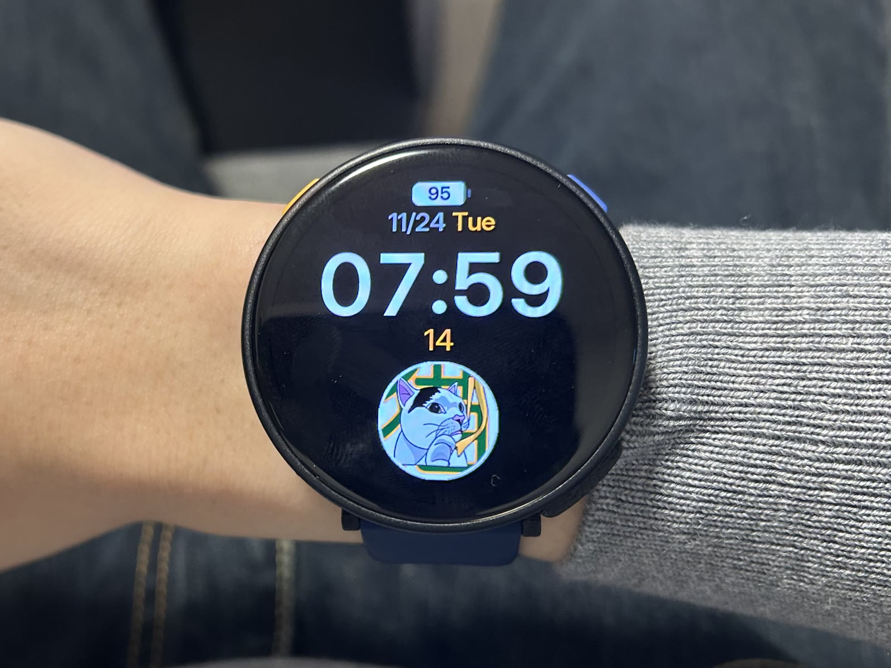
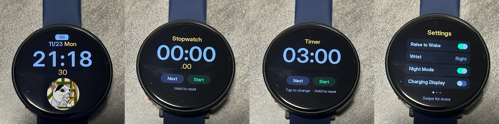

# M5StopWatch Watch

M5Stack StopWatch を Apple Watch の代わりに毎日着ける腕時計にするプロジェクトです。
ファームウェア（ESP-IDF）と、バンドアダプタ・充電スタンドの 3D プリントデータが入っています。

*Firmware and 3D-printable parts that turn the M5Stack StopWatch into an everyday wristwatch. Based on [M5StopWatch-PowerDemo](https://github.com/m5stack/M5StopWatch-PowerDemo) (MIT).*



## できること

- 手首を上げると画面が点灯します。BMI270 の動き検出でスリープから復帰し、復帰前の動き（FIFO）と姿勢から「時計を見たか」を判定します。腕を動かしてから表示まで約 0.7 秒で、腕を下ろすと消灯します。
- ボタン（KEYA / KEYB）を押すか、画面をタップしても点灯します。
- 画面：時計、ストップウォッチ、タイマー（振動と音で知らせる）、QR コード、設定。左右のスライドかボタンで切り替えます。
- 設定画面：手首で点けるか、着ける手（右／左）、夜は手首で点けない（1〜6 時）、充電中の常時表示、明るさ、振動、音量、今すぐ時刻合わせ、電源を切る。
- 時刻は Wi-Fi（NTP）で 1 日 1 回合わせます。
- 充電スタンドに立てている間は、暗めの置き時計になります。
- 1 時間ごとに電池の電圧、復帰した回数、点灯した時間を記録し、何に電力を使ったかを後から調べられます（`apps/watch/tools/battery_report.py`）。



電池（450mAh）は普段使いで平均 13〜18mA 前後を使い（実測）、1 日強もちます。目標の 2 日にはまだ届いていません。

## フォルダの構成

```text
apps/watch/   腕時計のファームウェア
3d-print/     バンドアダプタ・充電スタンド・端子キャップの 3D プリントデータ（→ 3d-print/README.md）
modules/      ボード用の共通モジュール（PowerDemo から。手首上げ・画面の電源などを追加）
tests/        PowerDemo の測定用ファーム ＋ 手首上げの実験用ファーム（imu_orient_diag、look_wake_l2、wrist_wake_l2）
```

## 書き込み方

1. ESP-IDF 5.5 を入れて有効にします（[公式の手順](https://docs.espressif.com/projects/esp-idf/en/stable/esp32s3/get-started/index.html)）。
2. リポジトリを取得します。

   ```sh
   git clone -b watch-app --recursive https://github.com/take20m/M5StopWatch-Watch.git
   cd M5StopWatch-Watch/apps/watch
   ```

3. Wi-Fi の時刻合わせを使うなら、`main/wifi_secrets.example.h` を `main/wifi_secrets.h` にコピーして、SSID とパスワードを書きます。
   QR コードの画面を使うなら、`main/watch_profile.example.h` を `main/watch_profile.h` にコピーして URL を書きます。
   どちらも git には入りません。ファイルがなければ、その機能は使いません。
4. ビルドして書き込みます。

   ```sh
   idf.py set-target esp32s3
   idf.py build
   idf.py -p /dev/cu.usbmodem* flash
   ```

- スリープ中は USB が切れます。書き込めないときは、手首を動かしてスリープから復帰させるか、電源ボタンを長押しして緑の LED が点滅したら離し、ダウンロードモードにします。ダウンロードモードから抜けるには電源ボタンを 1 回押します。
- `apps/watch/tools/flash_capture.sh <ログのファイル>` を実行すると、書き込んだあとログを記録し続けます。スリープして USB が切れても、つながり直すのを待ちます。
- 工場出荷時のファームウェアに戻したいときのために、最初に `esptool.py read_flash 0 0x1000000 backup.bin` で控えを取っておくことをおすすめします。
- 時計の文字盤に好きなキャラクターの画像や声を入れる仕組み（`apps/watch/tools/make_character.py`、`make_voices.py`）があります。画像や声は著作物なので、このリポジトリには入れていません。

## 注意

- 基板 v1.0 は背面ラベルの「BAT」ピンが実際には 5V 入力です（v1.0.1 で修正済み）。外付けの部品をつなぐ前に確認してください。
- 手首上げの判定は作者の手首（右手）と使い方に合わせて調整しています。しきい値は `apps/watch/main/main.cpp` の先頭にあります。

## ライセンス

[MIT License](LICENSE) です。元の PowerDemo（© M5Stack）と同じで、3D プリントデータも MIT です。
使っているライブラリとフォントのライセンスは [Third-Party Notices](THIRD_PARTY_NOTICES.md) と `apps/watch/main/fonts/OFL_*.txt` を見てください。

---

以下は、元の M5StopWatch Power Demo の説明です。

# M5StopWatch Power Demo

[English](README.md) | [简体中文](README_CN.md)

## Overview

This repository contains independent ESP-IDF firmware projects for measuring the power consumption of production M5StopWatch hardware. Each test is built and flashed separately, starts automatically after boot, and uses shared board-support modules.

The project is based on ESP-IDF 5.5.5.

> **Full Load safety gate:** Do not flash or run `tests/full_load` until the fixture rating, current limit, external temperature limit, and manual stop procedure have been reviewed. `CONFIG_M5SW_FULL_LOAD_SAFETY_ACK` is disabled by default.

## Power Test Results

Power consumption is represented by the average whole-board input current. Each measurement result uses the `WINDOW Avg` from an approximately 60-second measurement window. Device states are abbreviated here; follow the details link for the complete configuration.

| Test scenario | Device / operating state | Avg. current<br>at 3.7 V | Avg. current<br>at 4.2 V | Details |
|---|---|---:|---:|---|
| L0 shutdown | M5PM1: L0 shutdown<br>RX8130: backup domain powered | 8.89 uA | 9.08 uA | [Details](tests/l0_shutdown/README.md) |
| L1 standby | M5PM1: L1 standby<br>BMI270: powered; any-motion disabled<br>RX8130: powered; interrupts disabled | 20.49 uA | 20.67 uA | [Details](tests/l1_standby/README.md) |
| L2 deep sleep | ESP32-S3: Deep Sleep<br>M5PM1: L2 power configuration; I2C idle sleep enabled<br>BMI270: suspended | 90.06 uA | 51.65 uA | [Details](tests/l2_deepsleep/README.md) |
| IMU wake L1 full-feature mode | M5PM1: L1 standby; GPIO0 wake enabled<br>BMI270: accelerometer + gyroscope + wrist-wear wake-up + any-motion detection<br>RX8130: powered; interrupts disabled | 670.94 uA | 671.55 uA | [Details](tests/imu_wake_l1/README.md) |
| IMU wake L1 low-power mode | M5PM1: L1 standby; GPIO0 wake enabled<br>BMI270: accelerometer + any-motion detection<br>RX8130: powered; interrupts disabled | 37.56 uA | 39.17 uA | [Details](tests/imu_wake_l1/README.md) |
| IMU wake L2 full-feature mode | ESP32-S3: Deep Sleep<br>M5PM1: GPIO0 wake and I2C idle sleep enabled<br>BMI270: accelerometer + gyroscope + wrist-wear wake-up + any-motion detection | 708.35 uA | 694.76 uA | [Details](tests/imu_wake_l2/README.md) |
| IMU wake L2 low-power mode | ESP32-S3: Deep Sleep<br>M5PM1: GPIO0 wake and I2C idle sleep enabled<br>BMI270: accelerometer + any-motion detection | 73.91 uA | 60.50 uA | [Details](tests/imu_wake_l2/README.md) |
| RTC alarm wake L1 | M5PM1: L1 standby; GPIO0 wake enabled<br>RX8130: alarm armed<br>BMI270: any-motion disabled | 20.44 uA | 20.62 uA | [Details](tests/rtc_alarm_wake_l1/README.md) |
| RTC alarm wake L2 | ESP32-S3: Deep Sleep<br>M5PM1: GPIO0 wake and I2C idle sleep enabled<br>RX8130: alarm armed<br>BMI270: any-motion disabled | 57.06 uA | 43.44 uA | [Details](tests/rtc_alarm_wake_l2/README.md) |
| RTC timer wake L1 | M5PM1: L1 standby; GPIO0 wake enabled<br>RX8130: timer armed<br>BMI270: any-motion disabled | 20.46 uA | 20.52 uA | [Details](tests/rtc_time_wake_l1/README.md) |
| RTC timer wake L2 | ESP32-S3: Deep Sleep<br>M5PM1: GPIO0 wake enabled; I2C idle sleep disabled<br>RX8130: timer armed<br>BMI270: any-motion disabled | 630.98 uA | 622.45 uA | [Details](tests/rtc_time_wake_l2/README.md) |
| Normal operation | ESP32-S3: active<br>AMOLED: 50% brightness; 1 Hz refresh<br>BMI270: initialized; any-motion disabled<br>RX8130: powered; interrupts disabled<br>CST820: initialized; interrupt disabled | 45.69 mA | 44.53 mA | [Details](tests/normal_active/README.md) |
| Display workload | ESP32-S3: active<br>AMOLED: 100% brightness; static white frame<br>CST820: off<br>RX8130: off<br>BMI270: off<br>Wi-Fi: off | 154.45 mA | 144.24 mA | [Details](tests/display_only/README.md) |
| IMU sampling | ESP32-S3: active<br>BMI270: accelerometer + gyroscope + AUX sampled continuously<br>AMOLED: off<br>Wi-Fi: off<br>ES8311: off | 36.32 mA | 35.61 mA | [Details](tests/imu_sampling/README.md) |
| Wi-Fi idle connection | ESP32-S3: active<br>Wi-Fi: connected; power save `WIFI_PS_NONE`<br>AMOLED: off<br>BMI270: off<br>ES8311: off | 105.73 mA | 98.67 mA | [Details](tests/wifi_connected/README.md) |
| Wi-Fi Light Sleep | ESP32-S3: automatic Light Sleep<br>Wi-Fi: connected; power save `WIFI_PS_MAX_MODEM`<br>AMOLED: off<br>BMI270: off<br>ES8311: off | 3.49 mA | 3.43 mA | [Details](tests/wifi_light_sleep/README.md) |
| Wi-Fi periodic traffic | ESP32-S3: active<br>Wi-Fi: connected; power save `WIFI_PS_NONE`<br>ICMP traffic: one 64-byte packet every second<br>AMOLED: off<br>BMI270: off<br>ES8311: off | 105.09 mA | 97.83 mA | [Details](tests/wifi_periodic_traffic/README.md) |
| Full load | ESP32-S3: active<br>AMOLED: 50% brightness; continuous random drawing<br>ES8311: test tone active<br>I2S: audio stream active<br>Motor: 5 kHz; 100% duty<br>Wi-Fi: initialized; not connected or scanning<br>CST820: initialized | 285.77 mA | 276.32 mA | [Details](tests/full_load/README.md) |

L0 does not enable or test RTC functionality. The RX8130 backup domain remains physically connected and is included in the measured whole-board current.

## Measurement Graphs

All 3.7 V and 4.2 V graphs are collected in the [Power Measurement Graphs](docs/power-graphs/README.md) index.

## Repository Layout

```text
components/  Third-party libraries and fixed source snapshots
modules/     Shared M5StopWatch board and test-support components
tests/       Independent ESP-IDF firmware projects
```

## Build and Flash

Install and activate ESP-IDF 5.5.5, then initialize the repository dependencies:

```bash
git submodule update --init --recursive
```

Build and flash one test from its own directory:

```bash
cd tests/l0_shutdown
idf.py set-target esp32s3
idf.py build
idf.py flash monitor
```

Each test directory contains its own `sdkconfig.defaults`. Required third-party ESP-IDF components are included or pinned in this repository, so a generated `dependencies.lock` file is not required for a standard build.

## IMU Wake Modes

`tests/imu_wake_l1` and `tests/imu_wake_l2` each provide full-feature and low-power modes in the same firmware source. Select the mode before building by changing the corresponding `M5SW_IMU_WAKE_L1_REFERENCE_PROFILE` or `M5SW_IMU_WAKE_L2_REFERENCE_PROFILE` macro near the top of `main/main.cpp`:

```bash
# 0: 50 Hz accelerometer + any-motion detection mode
# 1: accelerometer + gyroscope + wrist-wear wake-up + any-motion detection mode
idf.py build
```

The firmware reports `profile_id=imu-wake-l1` or `profile_id=imu-wake-l2` in `BOARD_OK`. The `PROFILE=low_power` and `PROFILE=reference` fields identify the two modes; both modes use the same project identifier, sdkconfig, and build command.

## Measurement Method

1. Connect USB Type-C to flash the firmware and confirm `TEST_START`, `BOARD_OK`, and `TEST_READY` through the serial monitor.
2. Keep the same firmware and configuration, disconnect USB Type-C, and power the device only through the measurement setup.
3. Measure at 3.7 V and 4.2 V using an approximately 60-second `WINDOW`.

For tests with multiple modes, graph filenames without `-low` identify the full-feature mode, while the `-low` suffix identifies the low-power mode. Tests with one mode use filenames without a mode suffix.

The firmware does not detect the power source or switch between validation and measurement modes.

## Dependencies

- [M5GFX](https://github.com/m5stack/M5GFX) at `d91077b9a607b59404e4e4a49f775c792bfae382`
- [M5PM1](https://github.com/m5stack/M5PM1) at `be9a5456c007c333e7ac963f33bfde1ffa5d82ee`
- [M5IOE1](https://github.com/m5stack/M5IOE1) at `846eec7d05e25c09013be2acdb8804487f48a62e`
- [ic_rx8130](https://github.com/Ocean-lhy/ic_rx8130) at `d79bf99aa25168ab26886d0e94cf525be5a1343e`
- `otool_bmi270` (source snapshot included in `components/otool_bmi270`)
- `esp_codec_dev` 1.6.2 (vendored in `components/espressif__esp_codec_dev`)

Dependency revisions and licenses are summarized in [Third-Party Notices](THIRD_PARTY_NOTICES.md).

## License

Project-owned source code is released under the [MIT License](LICENSE). Third-party components remain subject to the licenses described in [Third-Party Notices](THIRD_PARTY_NOTICES.md).
